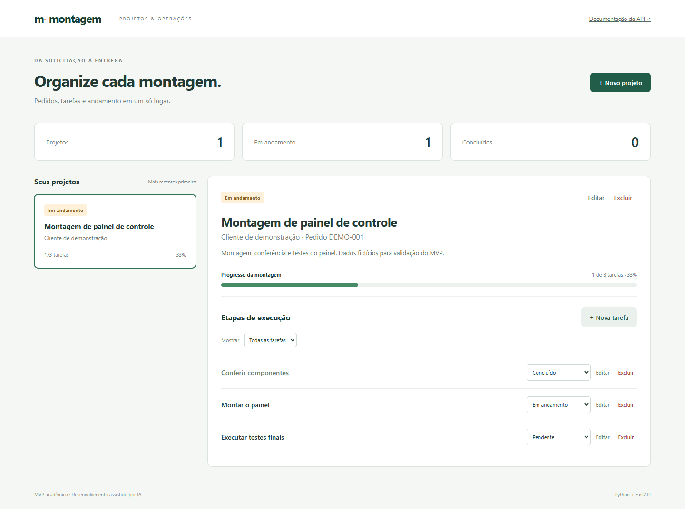

# Montagem · Projetos e tarefas

Gerenciador simples de pedidos de montagem de clientes, desenvolvido em Python e FastAPI
como miniprojeto de pós-graduação com auxílio de IA.

## Funcionalidades

- Criar, listar, editar e excluir projetos com cliente, título, pedido e descrição.
- Cadastrar, editar e excluir tarefas vinculadas a um projeto.
- Alterar tarefas entre pendente, em andamento e concluída; filtrar por status.
- Calcular automaticamente o progresso e o status do projeto.
- Usar pela interface web ou pela API REST documentada no Swagger UI.
- Persistir os dados em SQLite entre execuções.

Projeto sem tarefas fica pendente com 0%. Todas as tarefas concluídas resultam em 100%.
Reabrir uma tarefa ou adicionar uma etapa pendente recalcula o progresso.
Projetos com tarefas não podem ser excluídos antes da remoção das tarefas.



## Executar no Windows (PowerShell)

Pré-requisitos: Python 3.14 e Git. Execute a partir da raiz do projeto.

```powershell
git clone https://github.com/ncamilo/SistemaDesIA.git
cd SistemaDesIA
python -m venv .venv
.\.venv\Scripts\python.exe -m pip install -r requirements.txt
.\.venv\Scripts\python.exe -m uvicorn app.main:app --host 127.0.0.1 --port 8000
```

Abra http://127.0.0.1:8000 para a interface ou http://127.0.0.1:8000/docs para o Swagger UI.
Para encerrar, pressione Ctrl+C no terminal. Não é necessário ativar o ambiente virtual.

Linux/macOS: use `python3.14 -m venv .venv` e substitua `.venv\Scripts\python.exe`
por `.venv/bin/python` nos comandos seguintes.

O banco `montagem.db` é criado na pasta de execução e ignorado pelo Git.
Não apague esse arquivo para atualizar a aplicação. Para usar outro arquivo SQLite:

```powershell
$env:DATABASE_URL = 'sqlite:///./outro-banco.db'
```

## Exemplo de uso da API

Com o servidor em execução, em outro terminal PowerShell:

```powershell
$projeto = Invoke-RestMethod 'http://127.0.0.1:8000/api/projects' -Method Post -ContentType 'application/json' -Body '{"title":"Montagem de painel","customer":"Cliente exemplo","order_reference":"PED-001"}'
$tarefa = Invoke-RestMethod "http://127.0.0.1:8000/api/projects/$($projeto.id)/tasks" -Method Post -ContentType 'application/json' -Body '{"title":"Conferir componentes"}'
Invoke-RestMethod "http://127.0.0.1:8000/api/tasks/$($tarefa.id)" -Method Patch -ContentType 'application/json' -Body '{"status":"done"}'
Invoke-RestMethod "http://127.0.0.1:8000/api/projects/$($projeto.id)"
```

O último comando retorna projeto concluído com progresso de 100%.

| Método | Rota | Operação |
| --- | --- | --- |
| GET / POST | `/api/projects` | Listar / criar projetos |
| GET / PATCH / DELETE | `/api/projects/{id}` | Consultar / editar / excluir projeto |
| GET / POST | `/api/projects/{id}/tasks` | Listar / criar tarefas |
| PATCH / DELETE | `/api/tasks/{id}` | Editar / excluir tarefa |

Para filtrar, acrescente `?status=pending`, `?status=in_progress` ou `?status=done` à listagem de tarefas.
Erros: 404 para recurso inexistente, 409 para exclusão de projeto com tarefas e 422 para entrada inválida.
PATCH altera somente os campos enviados; campos nulos, desconhecidos e corpo vazio são rejeitados.

## Testes e qualidade

```powershell
.\.venv\Scripts\python.exe -m pytest -q
.\.venv\Scripts\ruff.exe check app tests
.\.venv\Scripts\ruff.exe format --check app tests
```

A suíte contém 40 casos, cobrindo cálculo do progresso, CRUD, validação, isolamento entre projetos,
filtros, reabertura, exclusão protegida e persistência após recriar a aplicação.
Cada teste de API usa seu próprio banco temporário. Os testes não alteram o banco de uso.
GitHub Actions executa os mesmos comandos em pushes e pull requests.

Há também quatro testes de interação em navegador real, em `browser_tests/`, cobrindo
clique no projeto já selecionado em desktop e celular, seleção pelo teclado, troca de
projeto, limpeza do filtro e mudança automática do status conforme a execução das tarefas.
Eles usam um servidor e banco temporários próprios.

```powershell
.\.venv\Scripts\python.exe -m pip install -r requirements-browser.txt
.\.venv\Scripts\python.exe -m playwright install chromium
.\.venv\Scripts\python.exe -m pytest browser_tests -q
```

Para usar o Edge instalado no Windows, defina `$env:PLAYWRIGHT_CHANNEL = 'msedge'`
e dispense o comando de instalação do Chromium. O CI executa esses testes em Chromium.

A versão instalada do Starlette emite aviso de depreciação ao utilizar TestClient com HTTPX;
a suíte continua funcional. Uma atualização futura do adaptador de testes poderá remover o aviso.

## Arquitetura e documentos

- `app/api.py`: rotas HTTP e injeção de sessão.
- `app/schemas.py`: contratos e validação de dados.
- `app/services.py`: regras de negócio e cálculo de progresso.
- `app/repositories.py`: consultas e persistência.
- `app/models.py` e `app/database.py`: esquema relacional e configuração SQLite.
- `app/static/`: interface HTML, CSS e JavaScript sem framework.
- `tests/`: testes unitários e de integração.

Veja [requisitos e arquitetura](docs/requisitos.md), [análise da apostila](docs/analise-apostila.md),
[fluxo de contribuição](CONTRIBUTING.md) e [uso da IA](docs/uso-ia.md).

Tecnologias: Python 3.14, FastAPI, Pydantic, SQLAlchemy, SQLite, Uvicorn, pytest, HTTPX e Ruff.
As versões resolvidas, incluindo dependências transitivas, estão em `requirements.txt`.

## Limitações e próximos passos

MVP destinado a uso local, sem autenticação nem autorização. Não o exponha diretamente à internet.
Não inclui estoque, anexos, responsáveis, prazos, notificações, faturamento ou controle de usuários.
Listagens ainda não têm paginação. O schema é criado na inicialização; mudanças futuras precisam de migrações.
Não há integração de IA em tempo de execução. Não há implantação em serviço de hospedagem.

Possíveis evoluções: autenticação, responsáveis e prazos, paginação e migrações com Alembic.
A versão inicial é `v0.1.0`; a entrega acadêmica final deve ser revisada pelo aluno antes de marcar `v1.0.0`.

## Créditos e licença

Autor: Nelson Camilo. Desenvolvimento assistido por Codex, com modelo GPT-6.
Base acadêmica: Unidade II da apostila fornecida pelo aluno; as capturas ficam fora do repositório.
Código disponibilizado sob [licença MIT](LICENSE). Dependências mantêm suas respectivas licenças.
