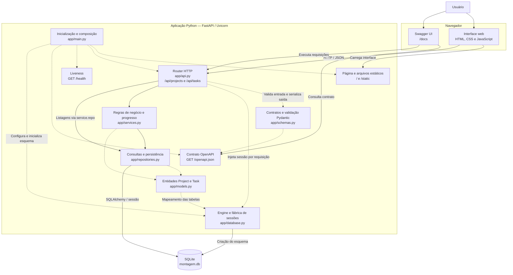

# Arquitetura de componentes

## Objetivo e contexto

Representar a arquitetura implementada no MVP de gerenciamento de projetos e tarefas
de montagem, versão funcional `v1.0.0`. A aplicação é um monólito modular executado
localmente: o FastAPI serve a interface, expõe a API e utiliza SQLite para persistência.

## Diagrama Mermaid

As setas contínuas representam chamadas ou acesso a dados. As setas tracejadas
representam configuração, contratos ou dependências estruturais.

O healthcheck não possui ligação com o banco: confirma que o processo responde,
sem medir disponibilidade dos dados. As rotas e os schemas alimentam o OpenAPI
gerado automaticamente pelo FastAPI.

## Responsabilidades

| Componente | Responsabilidade |
| --- | --- |
| `app/main.py` | Criar a aplicação, registrar rotas, servir a interface, tratar erros de negócio e gerenciar o ciclo de vida. |
| `app/static/` | Exibir projetos, tarefas, filtros e progresso; enviar requisições à API. |
| `app/api.py` | Receber requisições, injetar o serviço com sessão isolada e definir respostas HTTP. |
| `app/schemas.py` | Definir campos, limites, status e contratos de entrada/saída. |
| `app/services.py` | Validar existência, bloquear exclusão de projetos com tarefas e calcular status/progresso. |
| `app/repositories.py` | Consultar, salvar e excluir entidades com SQLAlchemy. |
| `app/models.py` | Mapear projetos e tarefas, relacionamento e restrições do banco. |
| `app/database.py` | Construir engine e fábrica de sessões e habilitar chaves estrangeiras SQLite. |

## Fluxo de uma operação

1. O usuário altera o status de uma tarefa pela interface.
2. O navegador envia `PATCH /api/tasks/{id}` com JSON.
3. FastAPI/Pydantic valida o payload; a dependência disponibiliza sessão e serviço.
4. O serviço verifica a tarefa e solicita sua gravação ao repositório.
5. O repositório confirma a transação no SQLite e a API retorna a tarefa atualizada.
6. A interface consulta novamente os projetos e as tarefas. O backend calcula o
   progresso e o status do projeto a partir das tarefas, sem duplicar esse estado no banco.

Nas listagens, as rotas também acessam o repositório por `service.repo`, conforme
a implementação atual. O diagrama não presume uma separação mais estrita do que existe.

## Inicialização, falhas e limites

- O esquema é criado na inicialização. Se o acesso ao banco falhar, o servidor
  continua acessível e as operações `/api/*` retornam 503.
- Nesse cenário, é necessário corrigir o acesso ao banco e reiniciar o servidor;
  não há recuperação automática nem verificação contínua de readiness.
- Os testes de API e navegador usam bancos temporários separados dos cadastros reais.
- Não há autenticação, microsserviços, mensageria ou serviços externos de IA.
- Priorização assistida está prevista no backlog como evolução futura; não existe
  componente de IA ativo ou custo de API no MVP.

## Referências

- [Escopo do MVP](escopo-mvp.md)
- [Requisitos](requisitos.md)
- [Contrato HTTP](contrato-http.md)
- [Backlog](backlog.md)
