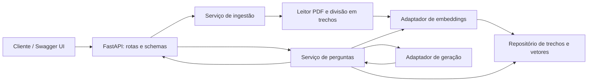

# Proposta de implementação

Estado: proposta, ainda não selecionada pelo aluno. As decisões abaixo são recomendações
de engenharia, não requisitos adicionais atribuídos à apostila.

## MVP recomendado: assistente de manual técnico

Objetivo: permitir perguntas sobre um único manual textual e devolver respostas com referências
às páginas e trechos usados. Um documento de demonstração próprio será suficiente para os testes.

### Requisitos e aceitação propostos

| ID | Requisito | Critério verificável |
| --- | --- | --- |
| RF01 | Ingerir PDF textual | Extrair texto com número da página e rejeitar documento vazio ou sem texto utilizável |
| RF02 | Dividir e indexar conteúdo | Preservar origem/página em cada trecho e gerar representações para recuperação semântica |
| RF03 | Consultar o documento | Recuperar trechos pertinentes e retornar resposta com fontes do documento selecionado |
| RF04 | Informar ausência de suporte | Responder que não encontrou informação suficiente nos casos de avaliação sem evidência |
| RF05 | Validar requisições | Rejeitar pergunta vazia e identificar documento inexistente com erro explícito |
| RF06 | Tratar falhas externas | Retornar erro controlado em timeout ou indisponibilidade do provedor |

A indicação de ausência de suporte será avaliada empiricamente; não constitui garantia de
eliminação de alucinações. Fontes citadas precisam pertencer aos trechos efetivamente recuperados.

Fora do MVP: OCR, diagramas/esquemas elétricos, consulta à internet, integração CAN/ESP32,
múltiplos usuários, treinamento de modelos e diagnóstico automático de equipamentos.

### Arquitetura proposta

Separar `api`, `schemas`, `services`, `repositories` e `adapters`, com dependências injetáveis.
Para um documento, armazenamento local simples basta; o mecanismo será escolhido antes da implementação.
Fornecedor, modelo e execução local ou remota permanecem em aberto, pois afetam custo e instalação.

### Plano de testes rastreáveis

| Camada | Casos | Requisitos |
| --- | --- | --- |
| Unitários | Divisão de texto, limites, metadados e preservação de página | RF01, RF02 |
| Unitários | Seleção de trechos e rejeição de citações fora do contexto | RF03 |
| Unitários | Ausência de evidência e falhas do adaptador | RF04, RF06 |
| Integração | Ingestão, persistência, consulta e leitura após reinício | RF01–RF03 |
| API | Pergunta válida, vazia, documento inexistente e erro externo | RF03–RF06 |
| Avaliação RAG | Conjunto fixo de perguntas com páginas esperadas e perguntas sem resposta | RF03, RF04 |

Usar pytest, TestClient e HTTPX. Nos testes determinísticos, substituir provedores externos
por adaptadores controlados, sem rede ou credenciais. Uma avaliação separada com o modelo real
deve registrar versão, configuração, relevância dos trechos, suporte das respostas e acerto das citações.
Testes com adaptadores simulados não comprovam a qualidade do modelo real.

Referências técnicas consultadas em 12/10/2026:
- https://fastapi.tiangolo.com/tutorial/testing/
- https://fastapi.tiangolo.com/tutorial/bigger-applications/

## Alternativa: API de tarefas de bancada

CRUD de tarefas de manutenção/estudo com título, descrição e status; conclusão e filtro por status;
persistência SQLite. Associar equipamento por campo textual simples, sem criar um sistema completo de manutenção.

Arquitetura: rotas FastAPI → serviços → repositório SQLAlchemy → SQLite.
Testar ciclo CRUD, validação, item inexistente, filtro, conclusão e persistência, com banco temporário isolado.
Não necessita integrar um modelo de IA à aplicação para atender ao trecho recebido da apostila.

## Sequência de trabalho

1. Selecionar domínio e fechar escopo/critério de pronto.
2. Criar remoto GitHub e registrar requisitos e decisões.
3. Configurar ambiente reproduzível e estrutura FastAPI.
4. Implementar uma funcionalidade vertical por vez com seus testes.
5. Automatizar testes no GitHub Actions e revisar mudanças por pull request.
6. Validar critérios de aceitação, exemplos e instalação em ambiente limpo.
7. Completar README, créditos e licença; publicar versão final e tag.
