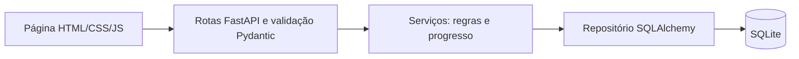

# Escopo aprovado: projetos de montagem

O aluno escolheu adaptar a Micro-API de Gerenciamento de Tarefas da apostila para pedidos
de montagem de clientes. Python e FastAPI foram definidos pelo aluno.

## MVP

Projeto: título, cliente, referência opcional do pedido e descrição.
Tarefa: título, descrição, projeto e status `pending`, `in_progress` ou `done`.
Uma página web simples permite cadastrar projetos, consultar suas tarefas e acompanhar a execução.
O progresso e o status do projeto são calculados a partir das tarefas, sem estado duplicado.

| ID | Requisito | Critério de aceitação |
| --- | --- | --- |
| RF01 | Cadastrar e consultar projetos | Cliente e título obrigatórios; pedido e descrição opcionais |
| RF02 | Editar e excluir projetos | Exclusão apenas quando não houver tarefas; projeto inexistente retorna 404 |
| RF03 | Cadastrar e consultar tarefas por projeto | Tarefa pertence a projeto existente; listas não misturam projetos |
| RF04 | Atualizar e excluir tarefas | Permite alteração de título, descrição e status; status inválido é rejeitado |
| RF05 | Filtrar tarefas por status | Retorna somente tarefas do projeto e status solicitados |
| RF06 | Calcular progresso | Sem tarefas: pendente e 0%; todas concluídas: concluído e 100%; avanço parcial: em andamento |
| RF07 | Persistir dados | Projetos e tarefas permanecem após reiniciar a aplicação |
| RF08 | Usar pela interface web | Criar projeto e tarefa, alterar status e visualizar progresso sem usar comandos HTTP |

Tarefas podem ser reabertas e o progresso é recalculado. Um projeto com tarefas todas pendentes
fica pendente. Qualquer tarefa iniciada ou concluída coloca o projeto em andamento, salvo quando
todas estiverem concluídas. Criar nova tarefa em projeto concluído reabre seu andamento.

Fora do MVP: login, múltiplas empresas, estoque, orçamento, emissão fiscal, anexos,
responsáveis, prazos, notificações, execução em equipamentos e IA integrada à aplicação.
A IA é utilizada no processo de desenvolvimento.

## Arquitetura

Uma aplicação, um banco local e uma interface servida pelo próprio FastAPI.
Dependência de sessão injetável para isolamento de testes. Criação automática das tabelas
na inicialização; mudanças futuras de esquema precisarão de migrações.

## Testes planejados

| Camada | Casos | Requisitos |
| --- | --- | --- |
| Unitários | Progresso sem tarefas, pendente, parcial e completo | RF06 |
| Integração/API | CRUD de projetos, validação e exclusão com tarefas | RF01, RF02 |
| Integração/API | CRUD de tarefas, projeto inexistente e isolamento entre projetos | RF03, RF04 |
| Integração/API | Filtro de status e rejeição de valores inválidos | RF05 |
| Integração/API | Conclusão, reabertura e persistência após reiniciar | RF06, RF07 |
| Interface | Entrega da página e roteiro de operação no navegador | RF08 |

pytest e TestClient/HTTPX; cada teste usa SQLite temporário, sem chamadas externas.
Asserções devem conferir o comportamento de negócio e a persistência, não apenas status HTTP.
CI executará lint e testes em pushes e pull requests.

## Decisões

- SQLite: instalação simples e suficiente para demonstração local de pequeno porte.
- SQLAlchemy: acesso aos dados separado das regras.
- Status do projeto derivado: impede conclusão com tarefas pendentes.
- Exclusão de projeto com tarefas bloqueada: exige remoção das tarefas antes.
- Sem autenticação no MVP: executar em localhost; acesso compartilhado exige evolução.
- Interface sem framework: reduz dependências e tempo de configuração.

Referências: https://fastapi.tiangolo.com/tutorial/testing/ e
https://fastapi.tiangolo.com/tutorial/bigger-applications/ (consultadas em 12/10/2026).
